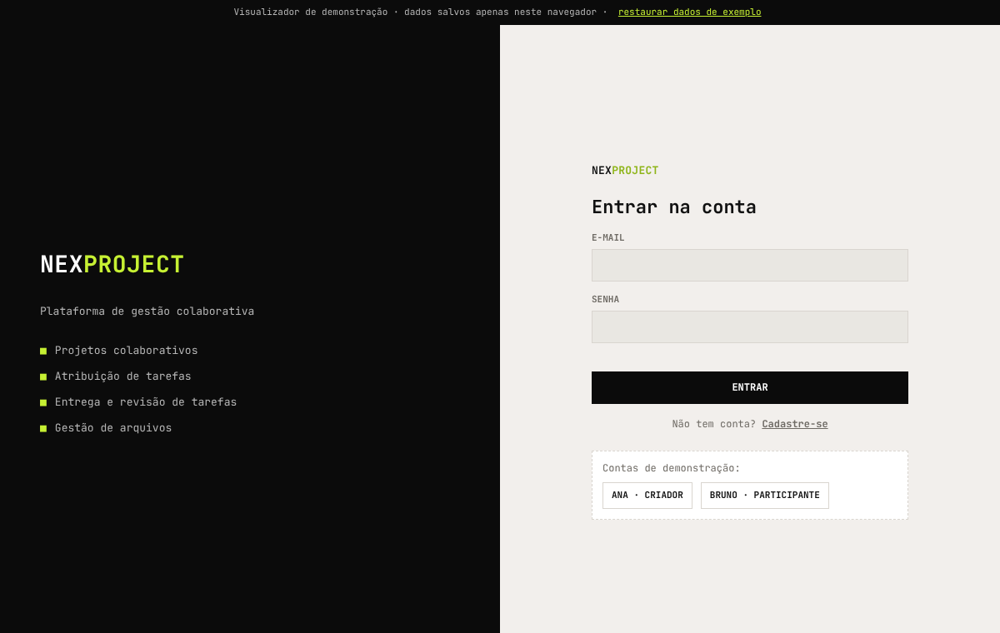
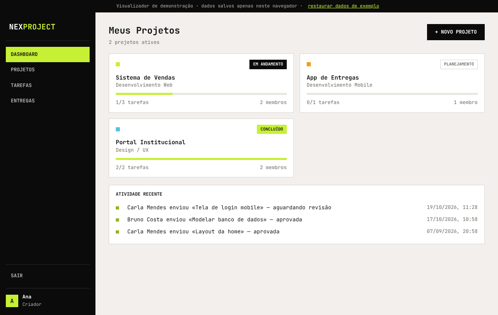
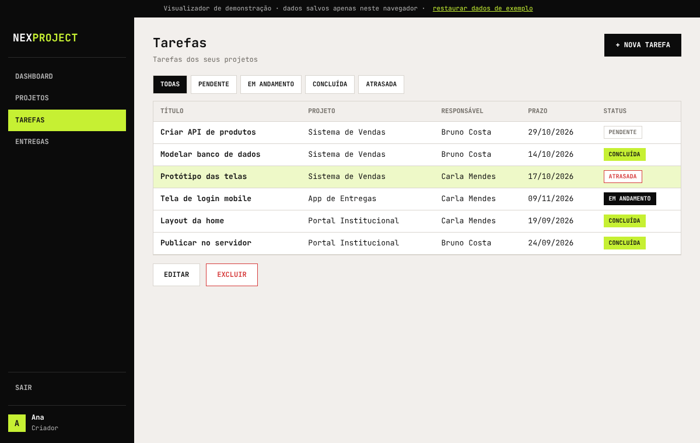
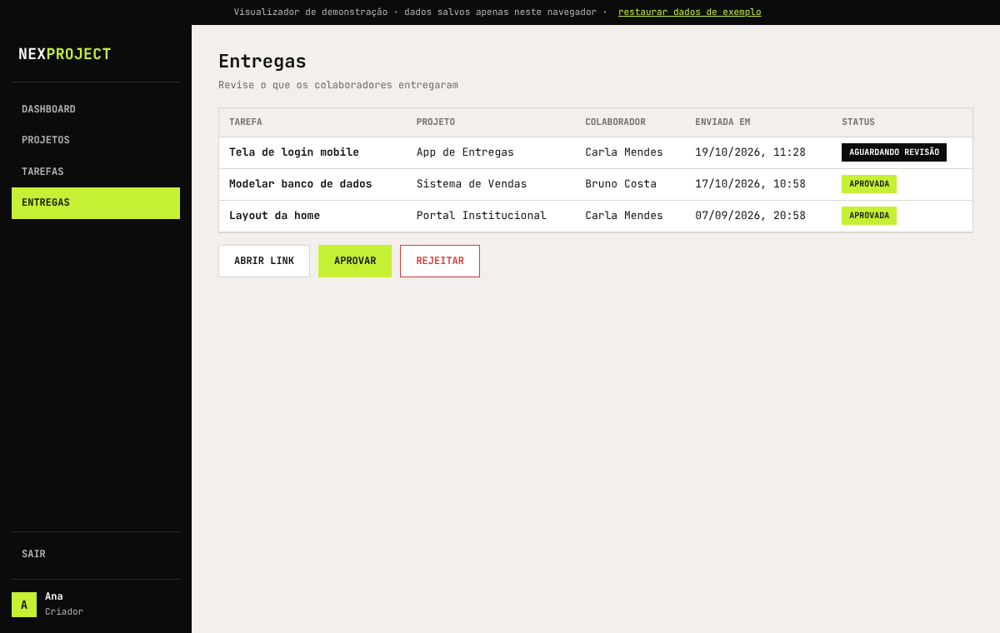

# NexProject — Gerenciador de Projetos e Tarefas

Sistema cliente/servidor em Java para gestão colaborativa de projetos, com dois perfis:
**Criador** (cria projetos e tarefas, revisa entregas) e **Participante** (recebe tarefas e envia entregas).

## Estrutura

| Pasta | Conteúdo |
|---|---|
| `cliente/` | Aplicação desktop Java Swing (projeto NetBeans/Ant) |
| `servidor/` | Servidor Java (socket na porta 4321) com acesso JDBC ao MySQL |
| `banco/` | Script do banco (`banco_dados_gerenciador_projetos.sql`) e migração (`migracao_nexproject.sql`) |
| `web/` | Visualizador web do app (HTML/CSS/JS puro, sem backend) |

## Visualizador web

**[▶ Abrir o visualizador](https://htmlpreview.github.io/?https://github.com/Omegaofi/gerenciador-tarefas/blob/main/web/index.html)** (pré-visualização direta do GitHub, sem instalar nada)

| Login | Dashboard |
|---|---|
|  |  |
| **Tarefas** | **Entregas** |
|  |  |

`web/index.html` reproduz as telas do cliente (login, cadastro, dashboard, projetos, tarefas e entregas)
com a mesma identidade visual e as mesmas regras de negócio, usando dados de exemplo salvos no
`localStorage` do navegador. Não se conecta ao servidor nem ao MySQL.

- Local: abra `web/index.html` no navegador, ou `npx http-server web`.
- Contas de demonstração (senha `123456`): `ana.silva@email.com` (Criador) e `bruno.costa@email.com` (Participante).
- GitHub Pages: o workflow `.github/workflows/pages.yml` publica a pasta `web/` (ative em *Settings → Pages → Source: GitHub Actions*).

## Executando o app Java

1. Rode `banco/banco_dados_gerenciador_projetos.sql` e depois `banco/migracao_nexproject.sql` no MySQL 8+.
2. Ajuste usuário/senha do banco em `servidor/src/factory/Conexao.java` (padrão: `localhost:3306`, usuário `root`, senha vazia).
3. Abra `servidor/` e `cliente/` no NetBeans; inicie o servidor e depois o cliente.
