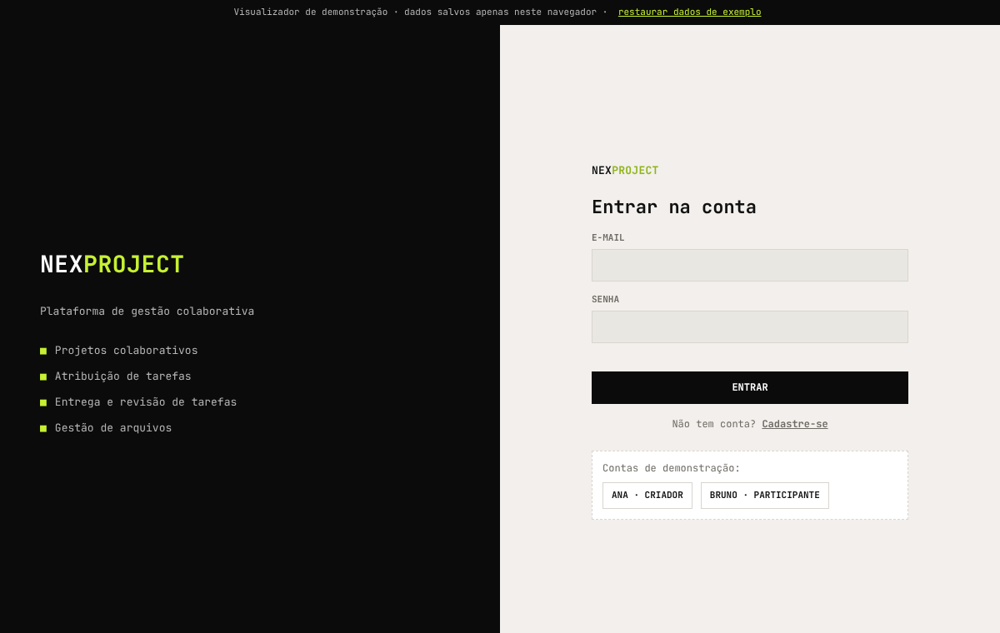
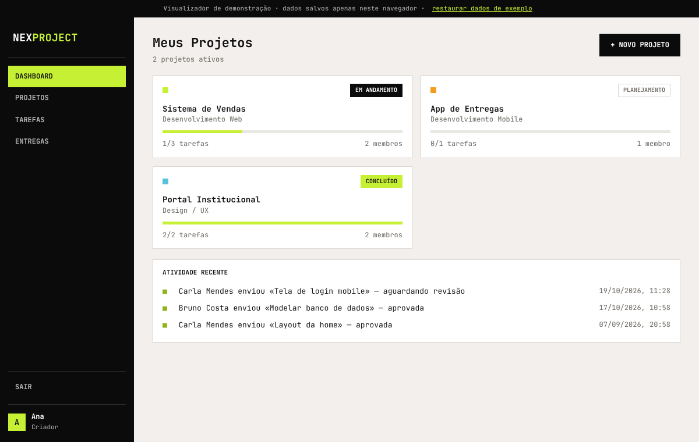
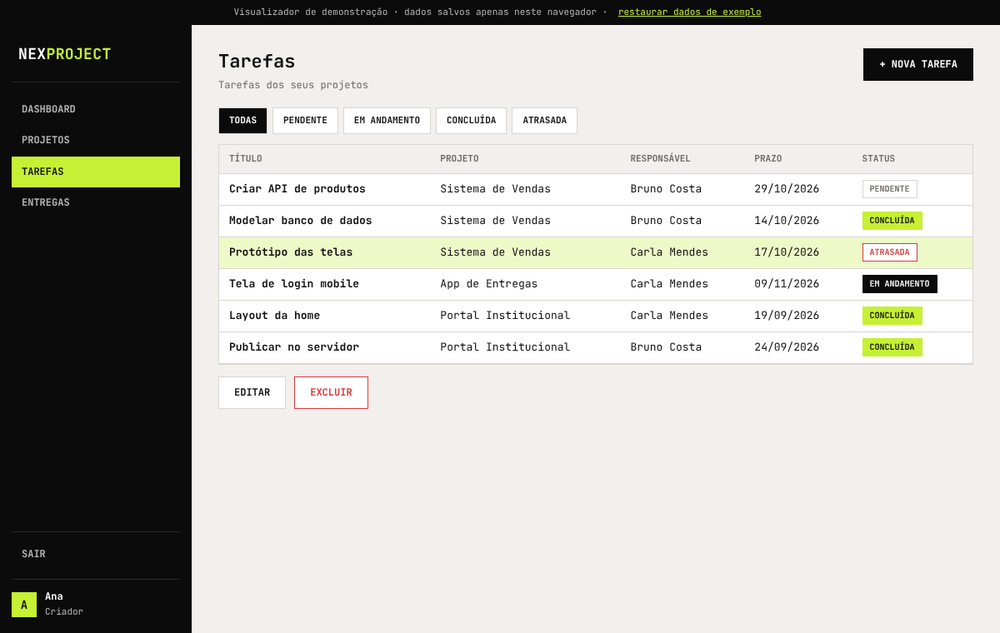
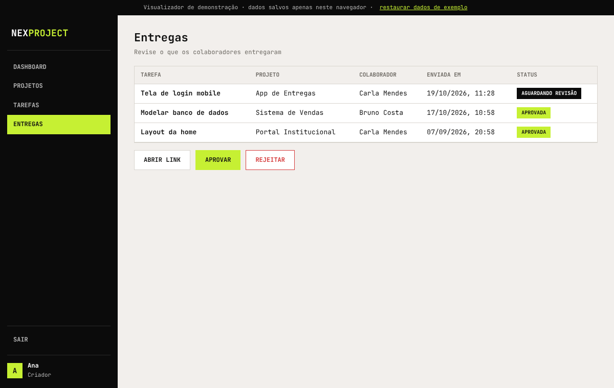
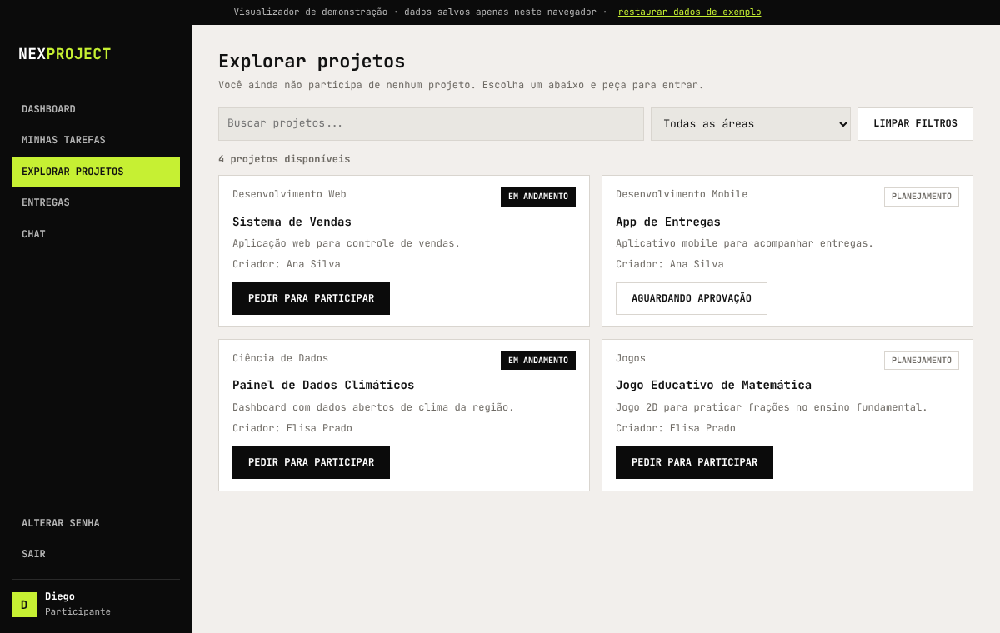
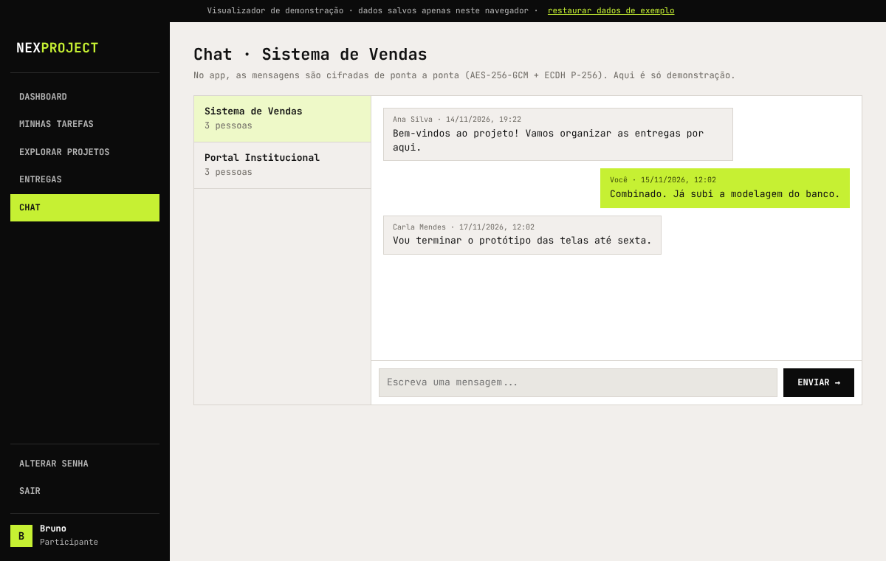

# NexProject — Gerenciador de Projetos e Tarefas

Trabalho interdisciplinar (Engenharia e Qualidade de Software — Técnico Integrado em Informática, IFSul Venâncio Aires).

Plataforma colaborativa em Java que conecta idealizadores de projetos a pessoas interessadas em participar,
com dois perfis:

- **Criador**: cria projetos e tarefas, aprova ou recusa inscrições, atribui tarefas aos membros e revisa entregas.
- **Participante**: explora projetos abertos, pede para participar, recebe tarefas e envia entregas.

Todos os membros de um projeto conversam no **chat do projeto, cifrado de ponta a ponta**.

## Estrutura

| Pasta | Conteúdo |
|---|---|
| `servidor/` | Servidor Java (socket na porta 4321) com acesso JDBC ao MySQL/MariaDB (projeto NetBeans/Ant) |
| `cliente/` | Aplicação desktop Java Swing (projeto NetBeans/Ant) |
| `android/` | Aplicativo Android (Gradle) que usa o mesmo servidor e o mesmo protocolo do desktop |
| `banco/` | Scripts SQL: banco completo e migrações |
| `lib/` | Bibliotecas usadas por cliente e servidor (`jbcrypt-0.4.jar`, `mysql-connector-j-8.3.0.jar`) |
| `web/` | Visualizador web do app (HTML/CSS/JS puro, sem backend) |

## Funcionalidades

| Função | Desktop (Swing) | Android |
|---|---|---|
| Login e cadastro (senha em BCrypt) | `TelaLogin1`, `TelaCadastro1` | `LoginActivity`, `CadastroActivity` |
| Dashboard | `TelaPrincipal1` | `InicioFragment` |
| Projetos (CRUD) | `TabelaProjeto1`, `FormProjeto1` | `ProjetosFragment`, `ProjetoFormActivity` |
| Tarefas (CRUD, só para membros do projeto) | `TabelaTarefa1`, `FormTarefa1` | `TarefasFragment`, `TarefaFormActivity` |
| Entregas e revisão | `TabelaEntrega1`, `FormEntrega1` | `EntregasFragment`, `EntregaFormActivity` |
| Explorar projetos e pedir para participar | `FormProcura` | `ExplorarFragment` |
| Aprovar/recusar inscrições | `TelaInscricoes` | `InscricoesActivity` |
| Chat do projeto cifrado | `TelaChat1` | `ConversasFragment`, `ChatActivity` |
| Alterar senha | `TelaTrocarSenha` | `TrocarSenhaActivity` |

### Chat cifrado de ponta a ponta

- Cada usuário tem um par de chaves **EC P-256**. A chave privada fica no banco trancada com a senha do usuário
  (PBKDF2-SHA256 + AES-GCM); só o próprio cliente consegue abri-la.
- Cada mensagem é cifrada com uma chave **AES-256-GCM** nova, e essa chave é cifrada (via ECDH) uma vez para cada membro do
  projeto (tabela `mensagem_chave`). O servidor guarda apenas texto cifrado.
- O código está em `cliente/src/.../cripto/` e `android/.../cripto/` (mesmas constantes), então mensagens enviadas
  pelo desktop abrem no celular e vice-versa.

## Executando

### Banco de dados

- **Instalação nova:** rode `banco/gerenciador_projetos.sql` (estrutura completa + dados de demonstração).
- **Atualizando um banco antigo:** rode, em ordem, `banco/migracao_nexproject.sql` e `banco/migracao_chat_cifrado.sql`.

Contas de demonstração (senha `123456`): `ana.silva@email.com` (Criador) e `bruno.costa@email.com` (Participante).
As chaves do chat são geradas automaticamente no primeiro login.

### Servidor e cliente desktop

1. Ajuste usuário/senha do banco em `servidor/src/factory/Conexao.java` (padrão: `localhost:3306`, usuário `root`, senha vazia).
2. Abra `servidor/` e `cliente/` no NetBeans (as bibliotecas já apontam para `../lib/`).
3. Inicie o servidor e depois o cliente.

### Android

Veja [`android/README.md`](android/README.md). Resumo: abra a pasta `android/` no Android Studio, inicie o servidor
no computador e rode o app. No emulador o endereço padrão `10.0.2.2:4321` já aponta para o computador; num celular
de verdade, informe o IP do computador na tela de login.

> **Importante:** o pacote `modelDominio` precisa continuar idêntico em `servidor/`, `cliente/` e `android/`
> (mesmos campos e `serialVersionUID`), pois os objetos são trocados por serialização Java.

## Visualizador web

**[▶ Abrir o visualizador](https://htmlpreview.github.io/?https://github.com/Omegaofi/gerenciador-tarefas/blob/main/web/index.html)** (pré-visualização direta do GitHub, sem instalar nada)

| Login | Dashboard |
|---|---|
|  |  |
| **Tarefas** | **Entregas** |
|  |  |
| **Explorar projetos** | **Chat do projeto** |
|  |  |

`web/index.html` reproduz as telas do cliente (login, cadastro, dashboard, projetos, inscrições, tarefas, entregas,
explorar projetos, chat e alterar senha) com a mesma identidade visual e as mesmas regras de negócio, usando dados
de exemplo salvos no `localStorage` do navegador. Não se conecta ao servidor nem ao MySQL, e o chat dele não é cifrado.

- Local: abra `web/index.html` no navegador, ou `npx http-server web`.
- Contas de demonstração (senha `123456`): `ana.silva@email.com` e `elisa.prado@email.com` (Criadores),
  `bruno.costa@email.com`, `carla.mendes@email.com` e `diego.rocha@email.com` (Participantes).
- GitHub Pages: o workflow `.github/workflows/pages.yml` publica a pasta `web/` (ative em *Settings → Pages → Source: GitHub Actions*).
